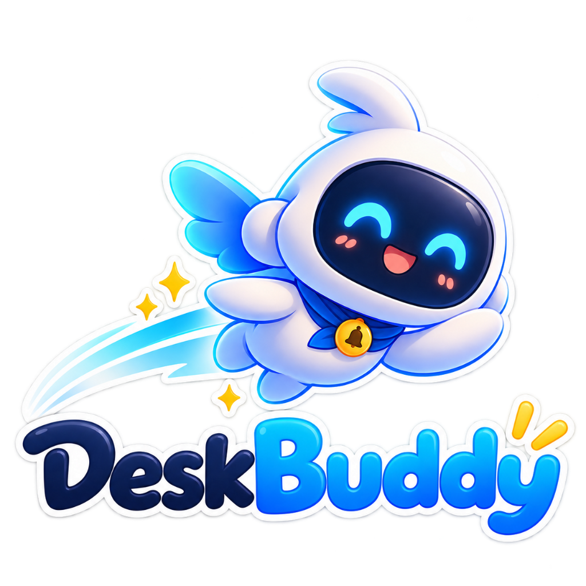

  

  # 🤖 DeskBuddy
  ### Your Intelligent Desktop Productivity Companion & Mascot

  
  
  
  

  

    <b>DeskBuddy</b> is an open-source desktop productivity application that combines smart task reminders, Google Calendar meeting synchronization, hydration wellness alerts, and an animated walking mascot overlay that brings your notifications to life directly on your screen.
  

  

    
    &nbsp;&nbsp;
    
  

---

## 🌟 Overview

Tired of dull system notification banners that get lost in your notification center? **DeskBuddy** re-imagines how desktop reminders work:

- 🚶 **Animated Screen Mascot**: An interactive character walks across your desktop to deliver reminders right when they are due, then walks away when dismissed.
- ⏰ **Smart Task & Alarm Scheduler**: Schedule one-off or recurring reminders (Daily, Weekly, Monthly) with custom snooze durations (5m, 10m, 15m, 30m).
- 💧 **Hydration & Posture Breaks**: Integrated drink water timer keeps you healthy throughout long coding or work sessions.
- 📅 **Google Calendar Meeting Sync**: Connect your Google Calendar to receive alerts 5 minutes before scheduled meetings with instant 1-click meeting join buttons.
- 🔕 **Do Not Disturb (DND)**: Instantly silence all overlays and alerts with a single toggle when you need uninterrupted focus.
- 🎨 **Rich Text Notes**: Attach rich notes with checklists, bold/italic formatting, and clickable web links to any reminder.

---

## 📥 Downloads & Releases

| Operating System | Architecture | Installer Type | Direct Link |
| :--- | :--- | :--- | :--- |
| **macOS** | Apple Silicon (`arm64` - M1 / M2 / M3 / M4) | `.dmg` Package | [Download .dmg](https://github.com/modhamanish/deskbuddy-app/releases/download/v1.0.0/DeskBuddy-1.0.0-arm64.dmg) |
| **macOS** | Apple Silicon (`arm64`) | `.zip` Portable | [Download .zip](https://github.com/modhamanish/deskbuddy-app/releases/download/v1.0.0/DeskBuddy-1.0.0-arm64-mac.zip) |
| **Windows** | 64-bit (`x64` - Windows 10 / 11) | Setup Installer `.exe` | [Download .exe](https://github.com/modhamanish/deskbuddy-app/releases/download/v1.0.0/DeskBuddy.Setup.1.0.0.exe) |

> 💡 *All installation packages can also be found on the [GitHub Releases Page](https://github.com/modhamanish/deskbuddy-app/releases).*

---

## 💻 Step-by-Step Installation Guide

### 🪟 Windows (Windows 10 / 11)

1. Download **`DeskBuddy Setup 1.0.0.exe`** from the link above or from [Releases](https://github.com/modhamanish/deskbuddy-app/releases).
2. Double-click the downloaded `.exe` file to begin installation.
3. **SmartScreen Notice**: Because DeskBuddy is an independent open-source application and is not signed with an enterprise certificate:
   - If Windows shows *"Windows protected your PC"* or *"SmartScreen prevented an unrecognized app from starting"*:
   - Click **`More info`**
   - Click **`Run anyway`**
4. Choose your destination folder and click **Install**.
5. Once installation finishes, DeskBuddy will automatically launch and place an icon in your **System Tray** (near the clock).

---

### 🍏 macOS (Apple Silicon M1 / M2 / M3 / M4)

1. Download **`DeskBuddy-1.0.0-arm64.dmg`** from the link above.
2. Double-click the downloaded `.dmg` file to mount it.
3. Drag the **DeskBuddy** icon into your **Applications** folder.
4. **First-Time Launch (macOS Gatekeeper)**:
   - When launching for the first time, macOS may display: *"DeskBuddy cannot be opened because Apple cannot check it for malicious software"*.
   - **Solution A**: Right-click (or `Control` + click) on **DeskBuddy** in your Applications folder and select **Open**, then click **Open** in the dialog.
   - **Solution B**: Open **System Settings** ➔ **Privacy & Security** ➔ Scroll down to the *Security* section ➔ Click **Open Anyway** next to DeskBuddy.
5. Grant accessibility/notification permissions when prompted so the mascot can overlay smoothly on your screen.

---

## 🚀 How to Use DeskBuddy

### 1. Creating a Reminder
1. Open the **DeskBuddy** dashboard.
2. Click the **`+ Add Reminder`** button.
3. Enter your title, optional description/checklist notes, date, and time.
4. *(Optional)* Toggle **Repeat** (Daily, Weekly, Monthly) or set custom priority (Low, Normal, High, Urgent).
5. Click **`Save Reminder`**.

### 2. When an Alert Triggers
- The companion character will walk onto your screen.
- The reminder card displays the title, notes, and action buttons:
  - **Snooze**: Postpones the alert by your default snooze duration (5, 10, 15, or 30 mins).
  - **Mark Done [✓]**: Completes the reminder.
  - **Dismiss [X]**: Hides the card and the companion mascot walks away.

### 3. Setting Up Google Calendar Sync
1. In the dashboard, locate the **Google Calendar** card.
2. Click **`Connect Google Calendar`**.
3. Sign in to your Google Account in the browser window and grant read-only calendar access.
4. DeskBuddy will automatically sync your meetings and notify you 5 minutes before every meeting with a 1-click **Join Meeting** button.

### 4. Hydration & Health Alerts
1. Click **`Settings`** in the top navigation bar.
2. Toggle **Drink Water Reminder** `ON`.
3. Select your preferred interval (e.g. every 30 mins, 45 mins, 60 mins).
4. DeskBuddy will notify you to drink water and maintain healthy posture throughout your workday.

---

## 🛠️ Technology Stack

- **Framework**: [Electron](https://www.electronjs.org/) + [electron-vite](https://electron-vite.org/)
- **UI Engine**: [React 19](https://react.dev/) + [TypeScript](https://www.typescriptlang.org/)
- **Styling**: [Tailwind CSS v4](https://tailwindcss.com/)
- **Icons**: [Lucide React](https://lucide.dev/)
- **Packaging**: [electron-builder](https://www.electron.build/)

---

## 👨‍💻 Created By

Crafted with care by **Modha Manish**.

- **LinkedIn**: [linkedin.com/in/modha-manish0969](https://www.linkedin.com/in/modha-manish0969)
- **GitHub**: [@modhamanish](https://github.com/modhamanish)

---

## 📄 License

This project is licensed under the [MIT License](LICENSE).
